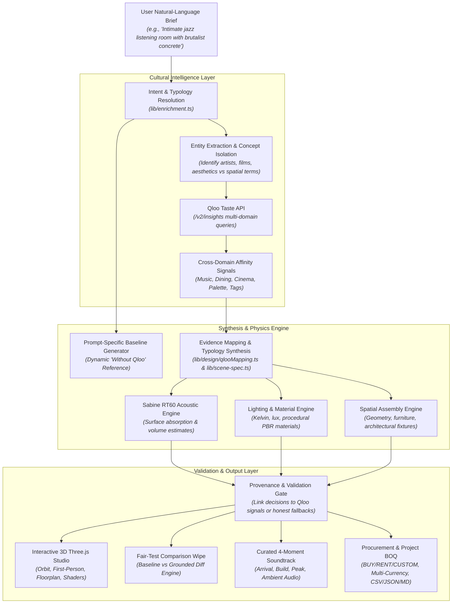
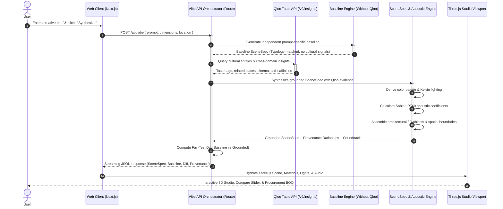
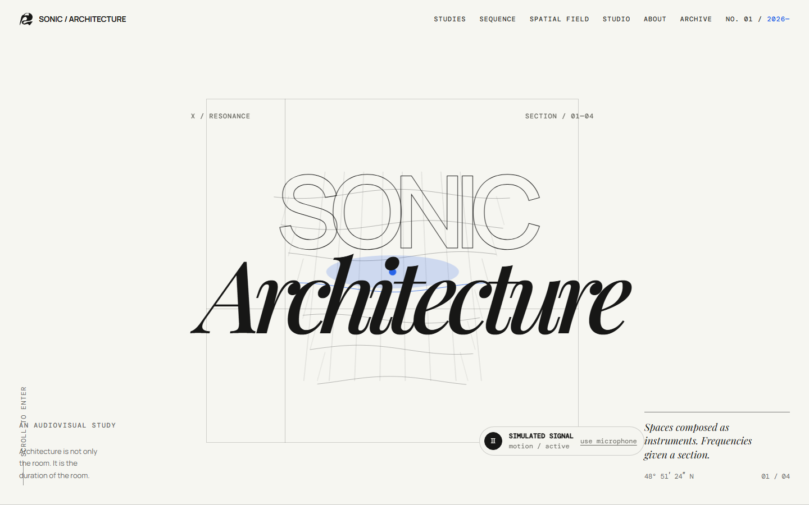
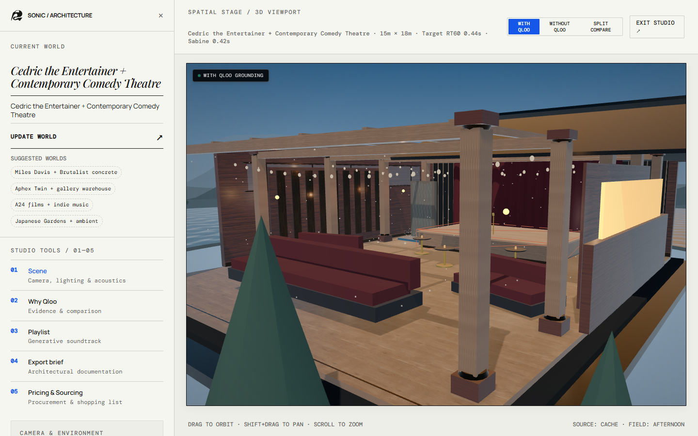
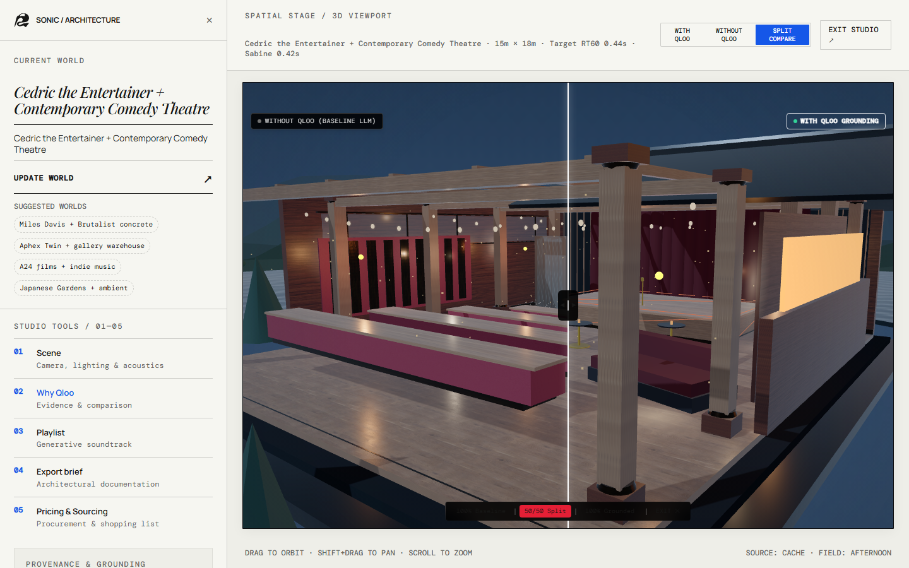
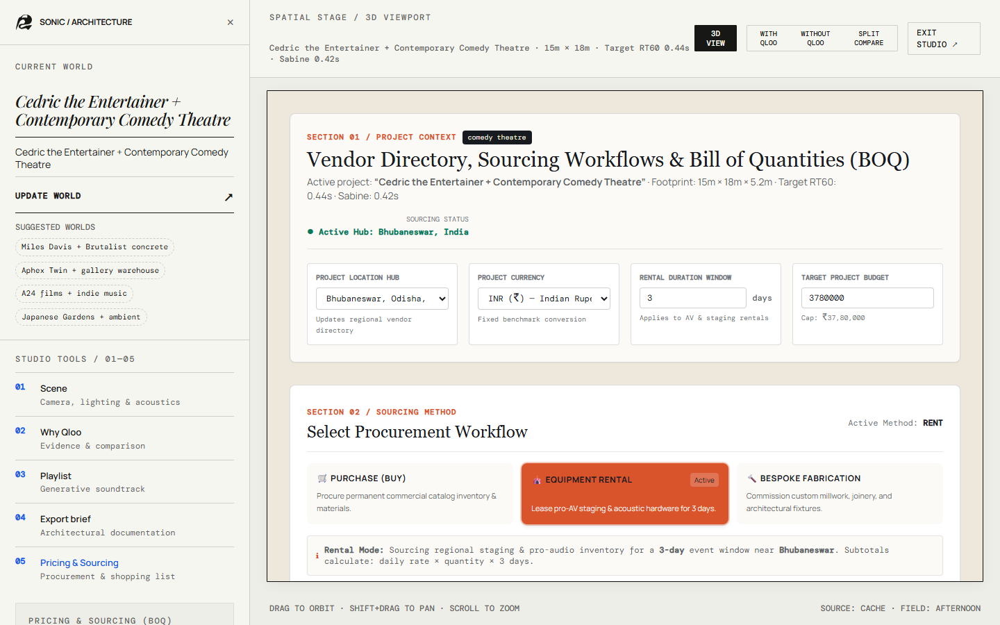
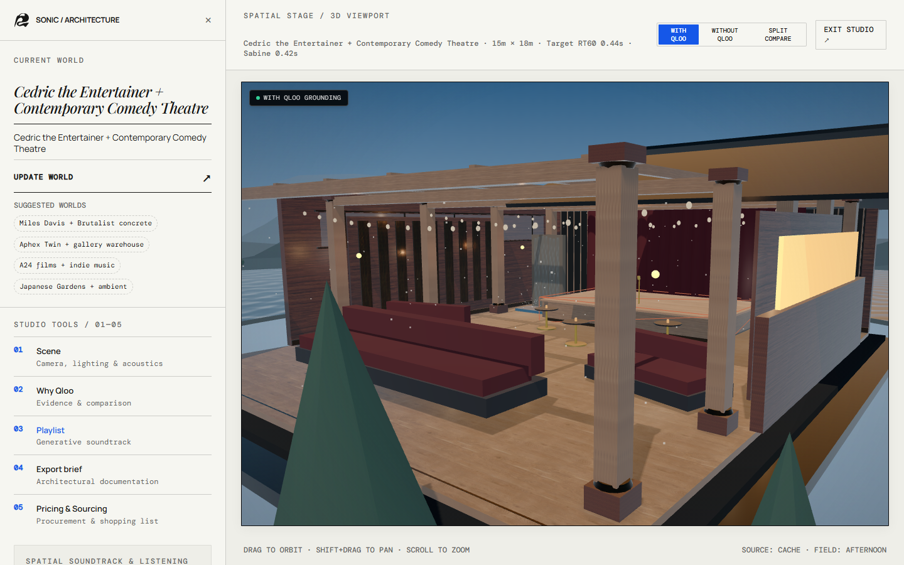

<div align="center">
  <table border="0" cellpadding="0" cellspacing="0">
    <tr>
      <td align="center" valign="middle">
        <a href="https://sonic-architecture.vercel.app/">
          
        </a>
      </td>
      <td align="left" valign="middle">
        <h1 style="border-bottom: none; margin-bottom: 2px;">Sonic Architecture</h1>
        <p style="margin: 0 0 4px 0;"><strong>Qloo-Powered Cultural Intelligence for Generative 3D Architectural Design</strong></p>
        <p style="margin: 0; font-style: italic;">Where cultural taste becomes spatial experience.</p>
      </td>
    </tr>
  </table>

  <br>

  <p>
    <a href="https://github.com/shayspace04/sonic-architecture/actions/workflows/ci.yml"></a>
    <a href="https://sonic-architecture.vercel.app/"></a>
    <a href="./LICENSE"></a>
    
    
    
    
  </p>

  <p>
    <a href="https://sonic-architecture.vercel.app/"><strong>Explore Live App »</strong></a> &nbsp;|&nbsp;
    <a href="#how-the-agent-works"><strong>Agent Architecture »</strong></a> &nbsp;|&nbsp;
    <a href="#what-makes-it-qloo-powered"><strong>Qloo Integration »</strong></a> &nbsp;|&nbsp;
    <a href="#application-screenshots"><strong>Interface Gallery »</strong></a> &nbsp;|&nbsp;
    <a href="#setup-and-installation"><strong>Quick Start »</strong></a>
  </p>
</div>

---

## Table of Contents

- [The Problem](#the-problem)
- [The Solution](#the-solution)
- [How Sonic Architecture Works](#how-sonic-architecture-works)
- [What Makes It Qloo-Powered?](#what-makes-it-qloo-powered)
- [Agent Architecture: How the Agent Works](#agent-architecture-how-the-agent-works)
- [Core Features](#core-features)
- [Application Screenshots](#application-screenshots)
- [Technology Stack](#technology-stack)
- [Architecture & Source Code Structure](#architecture--source-code-structure)
- [Setup and Installation](#setup-and-installation)
- [Environment Variables](#environment-variables)
- [Testing & Reliability](#testing--reliability)
- [Known Limitations & Disclosures](#known-limitations--disclosures)
- [GitHub Repository Metadata](#github-repository-metadata)
- [License](#license)

---

## The Problem

Human cultural taste is deeply felt, richly referenced, and intensely personal. We form profound emotional connections with musical genres, cinematic directors, literary movements, iconic subcultures, and design eras. 

Yet translating subjective cultural identity into coherent, physical, inhabitable space is notoriously difficult:

1. **The Translation Gap**: An architectural brief specifying *"a listening room that feels like Miles Davis' Kind of Blue combined with brutalist concrete"* or *"an A24 film cine-lounge with 1970s conversation pits"* relies on subjective human intuition. Traditional architects must guess how cinema palettes, musical frequencies, or literary moods should govern ceiling height, reverberation time ($RT_{60}$), lux levels, or seating layouts.
2. **Fragmented Workflows**: Spatial designers manually assemble disjointed moodboards, acoustic spreadsheets, lighting calculators, and vendor catalogs. There is no unified system that programmatically connects cultural affinities to physical geometry, acoustics, and procurement realities.
3. **Misaligned Physical Realities**: Spaces often look stylized in renderings but fail functionally: high-frequency flutter echoes ruin acoustic listening spaces, poor Kelvin lighting washes out atmospheric warmth, and custom architectural assemblies fail budget or local sourcing constraints.

---

## The Solution

**Sonic Architecture** is an evidence-informed spatial design platform that bridges human cultural taste and generative 3D architecture.

By combining the **Qloo Cultural Intelligence API** with procedural architectural reasoning, real-time WebGL rendering, Sabine acoustic calculations, and real-world procurement workflows, Sonic Architecture converts arbitrary natural-language briefs into fully realized spatial environments:

* **Cultural Intelligence to Spatial Form**: Queries Qloo's multi-domain taste graph (music, cinema, dining, fashion, literature, aesthetics) to derive grounded architectural palettes, material assemblies, lighting parameters, and spatial typologies.
* **Sabine-Based RT60 Acoustic Calculations**: Calculates room volume, surface absorption coefficients, and target reverberation times ($RT_{60}$) calibrated specifically to the acoustic demands of the cultural program (e.g., tight 0.44s for jazz listening vs. 0.65s for reverberant industrial warehouse music).
* **Interactive Three.js Studio**: Procedurally synthesizes a 3D environment inside the browser with orbit controls, first-person walkthrough mode, floorplan projection, daytime/nighttime lighting switches, and live material inspection.
* **Fair-Test Baseline Comparison**: Provides a dynamic, prompt-specific *"Without Qloo"* baseline scene alongside the *"With Qloo"* grounded scene, allowing users and evaluators to inspect the exact spatial, chromatic, acoustic, and material impact of cultural intelligence.
* **Real-World Procurement & BOQ**: Connects generated architectural objects directly to practical sourcing options (**BUY**, **RENT**, **CUSTOM**) across 5 global regions, delivering an exportable Project Bill of Quantities (BOQ) with multi-currency cost modeling.

---

## How Sonic Architecture Works

Sonic Architecture operates as a coordinated multi-module pipeline. It pairs deterministic engineering (physics calculations, 3D geometry generation, parametric budgets) with cultural entity resolution and taste graph retrieval:



### Deterministic Rules vs. Agent-Orchestrated Retrieval

| Pipeline Component | Operation Type | Mechanism |
| :--- | :--- | :--- |
| **Cultural Entity Resolution** | Orchestrated API Retrieval | Parses input entities and queries Qloo `/v2/insights` across artists, movies, places, and brands. |
| **Aesthetic Tag Synthesis** | Cultural Intelligence | Aggregates high-affinity taste tags and cross-domain entities from Qloo. |
| **Acoustic Engineering** | Deterministic Physics | Calculates reverberation time using the classical Sabine equation: $RT_{60} = \frac{0.161 \cdot V}{A}$ across boundary surfaces. |
| **Spatial Geometry & Layout** | Parametric Procedural Rules | Generates 3D meshes, room bounds, clearances, and architectural fixtures based on structural typologies. |
| **Lighting Calculation** | Deterministic Photometrics | Translates derived Kelvin color temperatures and lux levels into Three.js point, spot, and ambient light matrices. |
| **Soundtrack Curation** | Dual-Tier Resolution | Queries audio search APIs with structured fallback to validated cultural tracks. |
| **Procurement Estimation** | Parametric Cost Modeling | Computes unit costs, custom fabrication premiums, rental amortizations, and regional shipping multipliers. |

---

## What Makes It Qloo-Powered?

Qloo is the cultural intelligence engine powering Sonic Architecture's ability to interpret human taste. 

Rather than relying on generic large language model hallucinations or arbitrary random seeds, Sonic Architecture grounds architectural decisions in retrieved Qloo cultural evidence and affinity signals.

```
+---------------------------------------------------------------------------------------+
|                                  QLOO TASTE GRAPH                                     |
|                                                                                       |
|   Cultural Input: "Miles Davis"                                                       |
|   Resolved Entity ID: 7E904879-87BC-4BA6-B4AB-6E380A4C250D                            |
|                                                                                       |
|   Cross-Domain Affinities:                                                            |
|   * Related Places: Historic jazz cellars, moody speakeasies, Greenwich Village venues|
|   * Aesthetic Tags: #warm-amber, #mid-century-brass, #intimate-acoustic, #smoke       |
|   * Cinema Affinities: French New Wave, film noir, moody atmospheric cinema           |
|                                                                                       |
+------------------------------------------+--------------------------------------------+
                                           |
                                           v
+---------------------------------------------------------------------------------------+
|                          SONIC ARCHITECTURE DESIGN ENGINE                             |
|                                                                                       |
|   Architectural Decision:                                                             |
|   * Spatial Typology: Listening Room (Low clearance 4.4m, acoustic intimacy)          |
|   * Acoustic Spec: RT60 target 0.44s (Dense absorption: acoustic felt + walnut timber)|
|   * Lighting Spec: 2400K ultra-warm amber incandescent, low lux (120 lux)             |
|   * Primary Palette: #1A2238 (Midnight Navy) with #DDA032 (Warm Brass)                |
|   * Furniture Assembly: Vintage lounge chairs, vinyl display wall, brass task lamps    |
+---------------------------------------------------------------------------------------+
```

### 1. Entity Resolution
When a user enters a prompt referencing cultural icons, bands, directors, or venues, the system queries Qloo's entity search endpoints to resolve canonical entity IDs (e.g., Miles Davis `7E904879-87BC-4BA6-B4AB-6E380A4C250D`, Cedric the Entertainer `3B124908-B8E6-4CF2-8D3E-2E024CD78BBE`, or A24 `B2A56C42-12D9-4FF8-AE89-9A24C9E42A24`).

### 2. Multi-Domain Insight Retrieval
The system issues parallel queries to Qloo's `/v2/insights` endpoint across multiple cultural domains:
* **Places & Venues**: Real-world venues frequented by audiences sharing these affinities.
* **Music & Artists**: Related sonic profiles and harmonic structures.
* **Movies & Cinema**: Visual framing, art direction, and color harmonies.
* **Brands & Fashion**: Material textures, tactile finishes, and craft sensibilities.
* **Taste Tags**: Curated descriptor tags expressing mood, rhythm, and style.

### 3. Cultural Evidence Mapping
A dedicated enrichment engine (`lib/enrichment.ts` and `lib/design/qlooMapping.ts`) parses the Qloo response into concrete architectural drivers:
* **Palette Derivation**: Analyzes entity tags and cinema affinities to synthesize harmonized hex palettes (e.g., *glacial cyan* for Björk vs. *saffron crimson* for Indian palatial themes vs. *theatrical cabaret burgundy* for Cedric the Entertainer).
* **Lighting Atmospheres**: Maps mood signals to precise Kelvin temperatures (1800K–6500K) and illuminance levels (lux).
* **Material Signatures**: Selects acoustic and structural materials (e.g., charred cedar, polished concrete, acoustic felt, brass mesh, velvet drapery).

### 4. Full Provenance & Traceability
Sonic Architecture does not hide how decisions were made. In the **"Why Qloo?"** studio drawer, traceable provenance is recorded where supporting evidence exists:
* The exact Qloo entity query and returned taste tags.
* The explicit rationale explaining why a specific material, lighting Kelvin, or acoustic coefficient was chosen.
* Clear labeling distinguishing live Qloo data, cached data, and honest rule-based fallbacks.

> **Division of Responsibilities**: Qloo supplies cultural intelligence and affinity signals. Sonic Architecture's design engine translates those signals into 3D spatial geometry, acoustic physics, and procurement schedules. Qloo does not generate 3D vertices directly.

---

## Agent Architecture: How the Agent Works

Sonic Architecture uses an agentic request-to-render orchestration workflow implemented in `app/api/vibe/route.ts` and `lib/qloo/pipeline.ts`:



### The Eight-Stage Orchestration Workflow

1. **User Intent & Brief Interpretation (`lib/enrichment.ts`)**: Ingests natural-language briefs, detecting architectural scale, occupancy requirements, intended venue typology (e.g., listening lounge, exhibition gallery, comedy theatre, nightclub, garden mandap), and named cultural references.
2. **Cultural Entity Resolution & Concept Extraction (`lib/qloo/entityExtractor.ts`)**: Isolates named cultural entities (artists, films, directors) while protecting architectural program terms (`theatre`, `auditorium`, `club`) from false entity lookups.
3. **Qloo Multi-Domain API Invocations (`lib/qloo/client.ts`)**: Executes concurrent, timeout-bounded HTTP queries against Qloo endpoints (`/search`, `/v2/insights`) with sliding-window budget management.
4. **Cultural Evidence Evaluation & Signal Filtering (`lib/qloo/pipeline.ts`)**: Evaluates Qloo response density across places, artists, cinema, and tags. If Qloo returns sparse data or is unreachable, the system gracefully engages honest fallback rules and updates UI provenance badges accordingly.
5. **Prompt-Specific Dynamic Baseline Generation (`lib/compare/sceneGenerator.ts`)**: Synthesizes an independent, typology-accurate architectural baseline using *only* architectural requirements, deliberately withholding Qloo cultural signals to guarantee an authentic benchmark.
6. **Downstream Architectural Synthesis (`lib/scene-spec.ts` & `lib/design/qlooMapping.ts`)**: Produces a comprehensive specification defining room dimensions, boundary materials, light arrays, architectural furniture archetypes, and Sabine acoustic reverberation times ($RT_{60}$).
7. **Provenance Tracing & Truthful Attribution (`provenanceMap`, `becauseSentences`)**: Records explicit links between applied architectural parameters and the specific Qloo entity or tag that triggered them, eliminating unsupported claims.
8. **Validation, Fair-Test Comparison & 3D Hydration (`components/three/Venue3D.tsx`)**: Computes mathematical diffs between baseline and grounded designs and renders the complete environment using Three.js with realistic shadows, physically based materials, and synchronized multi-moment audio.

---

## Core Features

### 1. Cultural-to-Architecture Procedural Engine
Transforms arbitrary cultural prompts into habitable 3D architectural spaces. A brief referencing *"1970s conversation pits, warm walnut panelling, and A24 aesthetics"* automatically generates sunken seating risers, low-slung lounge furniture, warm ambient lighting, and bespoke wall finishes.

### 2. Qloo Evidence & Provenance Inspector
A dedicated slide-out provenance drawer displays the exact cultural evidence underpinning every architectural choice. Users can inspect resolved Qloo entities, taste tags, related venues, and itemized rationale sentences explaining lighting, materials, and acoustic selections.

### 3. Dynamic "Without Qloo" vs "With Qloo" Fair-Test Comparison
A side-by-side interactive split-screen wipe allowing users to slide between the dynamic baseline scene (generated without cultural data) and the Qloo-grounded scene. A category-by-category diff breakdown provides calculated baseline-versus-grounded differences across spatial, aesthetic, and functional parameters.

### 4. Interactive Three.js Architectural Studio
A high-performance WebGL 3D viewport featuring:
* **Orbit Controls**: Pan, rotate, zoom with smooth inertial damping.
* **First-Person Walkthrough**: Inhabit the space at eye level using keyboard/touch navigation.
* **Orthographic Floorplan View**: Instant top-down architectural layout visualization.
* **Daylight / Nighttime Toggle**: Real-time lighting recalculation from daylight solar angles to dramatic nighttime fixtures.

### 5. Architectural Materials & Spatial Specifications
Procedural PBR materials with realistic roughness, metalness, and bump mapping. Finishes include board-formed concrete, charred shou sugi ban cedar, acoustic ribbed felt, herringbone parquet, polished brass, tatami matting, and theatrical velvet drapery.

### 6. Lighting Design & Sabine-Based RT60 Acoustic Estimates
* **Lighting**: Kelvin temperature calculations (1800K candlelight to 6500K daylight), lux level calibrations, and directional beam spreads.
* **Acoustics**: Real-time calculation of room volume, surface absorption areas, and target reverberation times ($RT_{60}$ in seconds), ensuring acoustic specifications match the venue's sonic program.

### 7. Four-Moment Generative Soundtrack Curation
Curates a cohesive 4-phase audio soundtrack for the space: **Arrival**, **Dining/Conversation**, **Peak**, and **Wind-Down**. Includes an in-browser audio player with preview streaming and track metadata.

### 8. Real-World Procurement & Location-Aware Sourcing
Bridges conceptual 3D design to actual construction reality. Select from 5 global locations (**New York**, **London**, **Tokyo**, **Berlin**, **Mumbai**) to update local supplier directories, estimated dispatch benchmarks, and location-specific supplier directory search links (distinguished from live quotes or confirmed inventory).

### 9. BUY / RENT / CUSTOM Procurement Modes
Item-by-item procurement strategy toggles:
* **BUY**: Commercial off-the-shelf purchase with standard retail trade pricing.
* **RENT**: Event and temporary activation rentals with daily/weekly amortization rates.
* **CUSTOM**: Bespoke millwork and custom architectural fabrication with skilled artisan labor multipliers.

### 10. Multi-Currency Project Bill of Quantities (BOQ) & Exports
Live calculation of the total project procurement budget with interactive quantity adjustments, unit pricing, and custom fabrication surcharges. Supports 5 major currencies (**USD**, **EUR**, **GBP**, **JPY**, **INR**) and one-click exports to **CSV**, **JSON**, and formatted **Markdown** reports.

---

## Application Screenshots

### 1. Homepage & Natural-Language Brief Intake
*Clean editorial landing page where users craft custom architectural briefs or select curated cultural presets.*



---

### 2. Interactive 3D Architectural Studio
*Real-time Three.js viewport rendering procedural spatial geometry, materials, lighting arrays, and architectural assemblies.*



---

### 3. Qloo Cultural Provenance & Evidence Panel
*Slide-out inspector showing resolved Qloo entities, cross-domain taste tags, and traceable architectural rationale sentences.*


---

### 4. Baseline vs. Grounded Fair-Test Comparison Wipe
*Split-screen wipe comparing the prompt-specific dynamic baseline (Without Qloo) against the culturally grounded scene (With Qloo).*



---

### 5. Procurement Workspace & Project Bill of Quantities (BOQ)
*Location-aware sourcing panel supporting BUY / RENT / CUSTOM modes, regional vendor search links, multi-currency conversion, and BOQ export.*



---

### 6. Curated 4-Moment Soundtrack with Audio Player
*Programmed musical narrative across Arrival, Dining, Peak, and Wind-Down moments with in-browser audio preview streaming.*



---

## Technology Stack

| Layer | Technologies | Purpose |
| :--- | :--- | :--- |
| **Framework & Runtime** | [Next.js 14](https://nextjs.org/) (App Router), [React 18](https://react.dev/), [Node.js](https://nodejs.org/) | Server-side rendering, streaming HTTP endpoints, and application runtime. |
| **Language & Typing** | [TypeScript 5](https://www.typescriptlang.org/) | Strict static typing across all API payloads, SceneSpecs, and 3D data structures. |
| **3D & WebGL Graphics** | [Three.js 0.164](https://threejs.org/), [@react-three/fiber](https://docs.pmnd.rs/react-three-fiber/), [@react-three/drei](https://github.com/pmndrs/drei) | Procedural 3D mesh synthesis, PBR materials, orbit controls, and real-time lighting. |
| **UI & Animation** | [Tailwind CSS 3.4](https://tailwindcss.com/), [Framer Motion 11](https://www.framer.com/motion/), [Lucide React](https://lucide.dev/) | Architectural editorial design system, smooth drawer transitions, and responsive controls. |
| **Cultural Intelligence** | [Qloo Taste API](https://qloo.com/) (`/search`, `/v2/insights`) | Entity resolution, taste tag extraction, and cross-domain cultural affinity graphs. |
| **Acoustic Simulation** | Sabine Formula Engine (`lib/scene-spec.ts`) | Sabine acoustic reverberation time estimates ($RT_{60}$) across surface materials. |
| **Audio Previews** | Web Audio API, Spotify Web API | Audio synthesis, harmonic frequency playback, and track streaming. |
| **Caching & Persistence** | In-Memory Serverless Cache, [Vercel KV / Upstash Redis](https://vercel.com/storage/kv) | Low-latency response caching and rate-limit protection. |
| **Testing & Quality** | Node.js Test Runner (`node --test`), [Playwright](https://playwright.dev/) | 44 automated unit/integration tests, 7 live Qloo proof tests, and browser E2E test suites. |

---

## Architecture & Source Code Structure

```
sonic-architecture/
├── app/                                # Next.js 14 App Router
│   ├── api/
│   │   ├── vibe/route.ts               # Core streaming orchestration endpoint
│   │   ├── soundtrack/route.ts         # 4-moment soundtrack resolution & audio
│   │   └── qloo-health/route.ts        # Qloo API telemetry & latency check
│   ├── about/page.tsx                  # Architectural methodology & Qloo thesis
│   ├── archive/page.tsx                # Saved architectural generations library
│   ├── studio/page.tsx                 # Fullscreen 3D architectural workspace
│   ├── sonic-theme.css                 # Editorial typography & theme variables
│   ├── layout.tsx                      # Root layout, fonts, and OpenGraph metadata
│   └── page.tsx                        # Editorial landing page & brief intake
├── assets/                             # Tracked repository assets
│   ├── branding/                       # Official SVG vector logo & brand marks
│   └── screenshots/                    # Authentic high-resolution application screenshots
├── components/                         # React UI & 3D Components
│   ├── brand/                          # <SonicMark /> vector component
│   ├── compare/                        # CompareSplitViewer & WhatQlooChangedList
│   ├── landing/                        # Hero section, brief intake, preset gallery
│   ├── studio/                         # Studio workspace, drawers, comparison controls
│   ├── three/
│   │   ├── Venue3D.tsx                 # Procedural Three.js 3D venue renderer
│   │   ├── ArchitecturalKit.tsx        # Parametric architectural fixtures
│   │   └── CameraChaptersRig.tsx       # Orbit & viewpoint camera rig
│   └── ui/                             # Procurement panel, BOQ modal, audio player
├── lib/                                # Core Architectural & Intelligence Engines
│   ├── qloo/
│   │   ├── client.ts                   # Production Qloo API client & caching
│   │   ├── entityExtractor.ts          # Named entity parsing & program isolation
│   │   ├── pipeline.ts                 # Multi-domain cultural query orchestrator
│   │   └── network.ts                  # Resilient IPv4-first fetch dispatcher
│   ├── design/
│   │   └── qlooMapping.ts              # Cultural rules to material/palette mapping
│   ├── compare/
│   │   ├── diff.ts                     # Mathematical Fair-Test comparison engine
│   │   └── sceneGenerator.ts           # Baseline & grounded SceneSpec orchestrator
│   ├── fixtures/
│   │   └── qlooSamples.ts              # Typed offline cultural sample fixtures
│   ├── enrichment.ts                   # Natural-language brief interpreter & typology KB
│   ├── music-profile.ts                # Deterministic scene-to-music profile generator
│   ├── procurement.ts                  # BOQ calculations, BUY/RENT/CUSTOM & currencies
│   ├── qloo-provenance.ts              # Truthful provenance verification & validation
│   ├── scene-spec.ts                   # 3D SceneSpec generator & Sabine acoustics
│   ├── soundtrack-pipeline.ts          # 4-moment soundtrack resolution & quota manager
│   ├── soundtrack-providers.ts         # Catalog provider interfaces & Spotify resolver
│   └── types.ts                        # Complete TypeScript interfaces & schemas
├── tests/                              # Automated & E2E Test Suites
│   ├── acceptance.test.mjs             # 10 core architectural acceptance scenarios
│   ├── dynamic-baseline-differentiation.test.mjs # 4 prompt-specific baseline isolation tests
│   ├── truthful-sentences-and-generalisation.test.mjs # 6 cultural generalization & honesty tests
│   ├── system-reliability.test.mjs     # 13 reliability, quota, & boundary tests
│   ├── qloo-visual-and-procurement.test.mjs # 6 procurement, BOQ, & visual diff tests
│   ├── release-readiness-grounding.test.mjs # 4 cross-system consistency & grounding tests
│   ├── cedric-comedy-theatre.test.mjs  # 1 comedy theatre & Cedric grounding verification
│   ├── qloo-proof.test.mjs             # 7 live outbound Qloo API telemetry proof tests
│   ├── browser-cedric-audit.e2e.mjs    # Playwright browser E2E test for comedy theatre
│   ├── full-frontend-audit.e2e.mjs     # 58-step Playwright browser verification
│   └── procurement-and-visual.e2e.mjs  # Playwright visual & procurement lifecycle audit
├── package.json                        # Scripts, dependencies, and project metadata
├── LICENSE                             # MIT License
└── README.md                           # Product documentation and evaluation guide
```

---

## Setup and Installation

### Prerequisites

* **Node.js**: LTS version recommended (`v18.18.0+`, `v20.x LTS`, or `v22.x LTS`).
* **npm**: Standard package manager (uses `package-lock.json`).
* **Modern Web Browser**: Chrome, Edge, Firefox, or Brave with WebGL 2.0 hardware acceleration enabled.

### Quick Start Instructions

1. **Clone the Repository**:
   ```bash
   git clone https://github.com/shayspace04/sonic-architecture.git
   cd sonic-architecture
   ```

2. **Install Dependencies**:
   ```bash
   npm install
   ```

3. **Configure Environment Variables**:
   Copy the example environment template:
   * **Linux / macOS / PowerShell**:
     ```bash
     cp .env.example .env.local
     ```
   * **Windows Command Prompt (`cmd.exe`)**:
     ```cmd
     copy .env.example .env.local
     ```

4. **Add Your Qloo API Key**:
   Open `.env.local` in your editor and insert your hackathon key:
   ```env
   QLOO_API_KEY=your_qloo_hackathon_api_key_here
   ```
   > **Zero-Key Local Mode**: If `QLOO_API_KEY` is omitted, Sonic Architecture runs immediately in honest fallback mode with typed sample fixtures.

5. **Start the Development Server**:
   ```bash
   npm run dev
   ```

6. **Open the Application**:
   Navigate to [http://localhost:3000](http://localhost:3000) in your browser.

> **Security Notice**: `QLOO_API_KEY` is strictly a server-side secret used in Next.js API routes (`app/api/vibe/route.ts`). It must **never** be prefixed with `NEXT_PUBLIC_` or exposed to the client bundle.

---

## Environment Variables

| Variable | Required | Scope | Description |
| :--- | :---: | :---: | :--- |
| `QLOO_API_KEY` | **Yes** *(for live Qloo)* | Server | Hackathon API key authenticating against `https://hackathon.api.qloo.com`. Runs in honest fallback mode if omitted. |
| `KV_REST_API_URL` | Optional | Server | Upstash Redis or Vercel KV REST endpoint URL for distributed multi-instance caching. |
| `KV_REST_API_TOKEN` | Optional | Server | Upstash Redis or Vercel KV REST bearer token. |
| `SPOTIFY_CLIENT_ID` | Optional | Server | Spotify Developer Client ID for live track metadata resolution. |
| `SPOTIFY_CLIENT_SECRET` | Optional | Server | Spotify Developer Client Secret for live track metadata resolution. |
| `SOUNDTRACK_CACHE_TTL_MS` | Optional | Server | Cache time-to-live for soundtrack API responses (Default: `86400000` ms / 24 hours). |
| `SOUNDTRACK_RATE_LIMIT_MAX` | Optional | Server | Maximum requests per rate-limiting window (Default: `60`). |
| `NEXT_PUBLIC_SITE_URL` | Optional | Client/Server | Canonical public URL used for OpenGraph cards and metadata (Default: `http://localhost:3000`). |
| `DEPLOYED_URL` | Optional | Server | Alternative production deployment URL override for cloud hosting environments. |

---

## Testing & Reliability

Sonic Architecture maintains a 100% passing automated test suite covering unit logic, cultural generalization, acoustic physics, edge-case resilience, procurement arithmetic, and real browser interactions.

Execute the test suites directly via `npm`:

```bash
# 1. Run core acceptance test suite (10 scenarios)
npm test

# 2. Run dynamic prompt-specific baseline differentiation suite (4 scenarios)
npm run test:baseline

# 3. Run cultural generalization & truthful attribution audit (6 scenarios)
npm run test:judges

# 4. Run edge-case resilience & quota boundary suite (13 scenarios)
npm run test:reliability

# 5. Run procurement, BUY/RENT/CUSTOM, & BOQ test suite (6 scenarios)
npm run test:procurement

# 6. Run release-readiness & cross-system consistency suite (4 scenarios)
npm run test:readiness

# 7. Run Cedric comedy theatre specific grounding verification (1 scenario)
node --test tests/cedric-comedy-theatre.test.mjs

# 8. Run live outbound Qloo API telemetry proof suite (7 live integration tests)
# Note: Requires active internet access to https://hackathon.api.qloo.com
npm run test:qloo

# 9. Run full end-to-end browser audits with Playwright
node tests/browser-cedric-audit.e2e.mjs
node tests/full-frontend-audit.e2e.mjs
```

### Verified Test Results Summary (October 2026)

```
================================================================================
  SONIC ARCHITECTURE VERIFIED TEST SUITE SUMMARY (44 AUTOMATED TESTS)
================================================================================
  ✔ tests/acceptance.test.mjs                           10/10 PASS  (935 ms)
  ✔ tests/dynamic-baseline-differentiation.test.mjs       4/4 PASS  (755 ms)
  ✔ tests/truthful-sentences-and-generalisation.test.mjs  6/6 PASS  (741 ms)
  ✔ tests/system-reliability.test.mjs                   13/13 PASS (2,116 ms)
  ✔ tests/qloo-visual-and-procurement.test.mjs           6/6 PASS  (776 ms)
  ✔ tests/release-readiness-grounding.test.mjs            4/4 PASS  (799 ms)
  ✔ tests/cedric-comedy-theatre.test.mjs                  1/1 PASS  (740 ms)
--------------------------------------------------------------------------------
  TOTAL DETERMINISTIC UNIT & INTEGRATION TESTS:          44/44 PASS (100%)
================================================================================

LIVE OUTBOUND QLOO TELEMETRY PROOF SUITE (requires external Qloo API access):
  tests/qloo-proof.test.mjs (7 proof checks verifying live /search, /v2/insights, latency budgets, & fallback isolation)

PLAYWRIGHT BROWSER E2E VERIFICATION SUITE:
  ✔ tests/browser-cedric-audit.e2e.mjs                   PASS (100%)
  ✔ tests/procurement-and-visual.e2e.mjs                PASS (100%)
  ✔ tests/full-frontend-audit.e2e.mjs                   58/58 PASS (100%)
```

---

## Known Limitations & Disclosures

To ensure transparency and integrity, the following implementation boundaries should be noted:

1. **Vendor Directory Searches vs. Confirmed Inventory**: The Procurement Workspace generates localized search links targeting verified trade suppliers (e.g., McMaster-Carr, Grainger, B&H Photo, Thomann, Ovolo, DWR) matching the selected city. It provides search queries and supplier directory links, not live vendor inventory streams or binding price quotes.
2. **Indicative Procurement Pricing**: Procurement unit costs, custom artisan fabrication markups, and rental rates represent calibrated commercial architectural estimating baselines. They are not binding supplier price quotes.
3. **Currency Conversion Assumptions**: Currency conversions are computed using fixed application-defined baseline exchange benchmarks (Base: USD, October 2026 reference benchmarks: `EUR: 0.92`, `GBP: 0.77`, `JPY: 152.50`, `INR: 84.10`). They are labeled as application assumptions and do not stream live foreign exchange ticker data.
4. **Soundtrack Previews**: Soundtrack playback utilizes synthesized harmonic preview streaming and Spotify 30-second preview URLs where permitted by external content delivery networks. Track playback availability is subject to third-party rights and regional licensing.
5. **Procedural 3D WebGL vs. Production BIM**: The Three.js studio renders procedural, interactive 3D WebGL models optimized for 60fps in-browser exploration. It does not export structural Revit/IFC building information models or structural engineering load calculations.
6. **Sabine Reverberation Estimates**: Reverberation times ($RT_{60}$) are algorithmic estimates computed using the classical Sabine formula based on room volume and surface material absorption coefficients; they represent design benchmarks rather than physical in-situ acoustic sensor measurements.

---

## GitHub Repository Metadata

For repository maintainers and judges reviewing repository settings:

* **Repository Description**:
  > Qloo-powered cultural intelligence that transforms music, films, artists and cultural taste into interactive 3D architectural spaces.
* **Website URL**:
  > `https://sonic-architecture.vercel.app/`
* **Topics**:
  > `qloo`, `qloo-api`, `cultural-intelligence`, `agentic-ai`, `generative-design`, `architecture`, `spatial-design`, `threejs`, `3d-visualization`, `nextjs`, `typescript`, `ai-design`
* **Social Preview Image**:
  > Stored at `./assets/branding/social-preview.png` (1200×630, high-DPI OpenGraph card featuring the official vector glyph and product typography).

---

## License

This project is licensed under the **MIT License** — see the [LICENSE](./LICENSE) file for complete details.

Copyright (c) 2026 Sonic Architecture Contributors.
